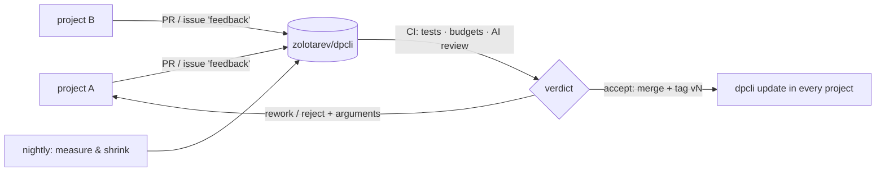

# Roadmap

Goal: a self-improving network with a single hub. Every project using dpcli logs the frictions its agents hit, fixes project-specific ones locally and sends dpcli-level fixes here as pull requests; CI reviews and merges them; every project picks them up on its next update.

## Phases

| # | Phase | What it delivers |
|---|---|---|
| 0a | English & presentation | Everything in English; `language.text` / `language.commits` chosen at install; README, docs, contributing, security, templates |
| 1 | Project layer `.dpcli-local/` | Project rules, agent additions (`<agent>.append.md`), own skills and the friction ledger live in the project and survive updates |
| 2 | Self-improvement | `dpcli feedback` (dedup, clusters, triage project/dpcli, fix/wontfix, regression after fix), `dpcli stats`, `harness-retro` on top of them, `dpcli contribute` (PR from origin or fork, `+1` instead of duplicates, issue fallback) |
| 3 | Auto-update | `dpcli update [--auto] [--pin vN]` on SessionStart once a day: fast-forward to the latest tag, re-render with the project layer, commit the submodule pointer; report the fate of own PRs (merged / rework / rejected) |
| 4 | Installer | `curl … install.sh \| bash`: submodule, config (language, worktree setup), `init`, optional modern tools; migrates a vendored copy |
| 5 | Fast tools | Agents use `rg`, `fd`, `jq`, `ast-grep`, Read with offset; dpcli batches git calls in `status`/`gc` and pre-filters with `rg` |
| 5b | The hub's CI | `test.yml` (tests, VERSION/CHANGELOG, anonymity, budgets), `review.yml` (AI verdict; `tools/decide.py` merges + tags, labels rework or closes), `nightly.yml` (measure lightness, one shrinking PR) |
| ✓ | Phases 0a–5b | released in v4–v9 and the hub CI |
| 6+ | Fixes driven by the ledger | Ordered by frequency of `feedback` issues and their `+1`s |

## Known frictions to start with
From the first production use (one project, ~20 modules, 186 executor reports; a report may count in several rows):

| Friction | Reports |
|---|---|
| `accept --dry` runs 2–15 min in the foreground and hits the agent's tool timeout | 45 |
| plan section referenced by a card is not found (multi-word section names) | 31 |
| false `scope` failures (free text in paths, scope/dont_touch overlap, files the task must touch) | 30 |
| `task show` truncates addenda | 23 |
| report taken from a shared `/tmp/r.json` written by another agent | 16 |
| shared test DB / ports between parallel copies | 17 |
| `lock cpu` goes to background and loses output | 12 |
| job names shared between copies | 6 |
| `git stash` is shared by all worktrees | 6 |
| no baseline: pre-existing failures look like new ones | 5 |
