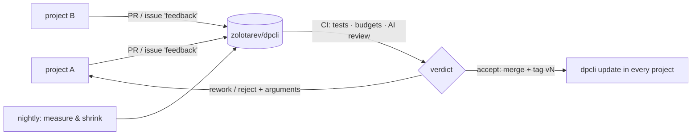

# Roadmap

Goal: a self-improving network with a single hub. Every project using dpcli logs the frictions its agents hit, fixes project-specific ones locally and sends dpcli-level fixes here as pull requests; CI reviews and merges them; every project picks them up on its next update.

## Done
- v4–v9: English and language settings, project layer `.dpcli-local/`, friction ledger (`feedback`, `stats`, `contribute`), auto-update, installer, fast tools.
- Hub CI: tests, lightness budgets, AI review with verdict, automatic merge/rework/reject and release, PRs synced with main before review, nightly simplification (a nightly PR sent back for rework is replaced by a fresh one).
- v10–v17: fixes from the first project's ledger — 8 of 10 friction clusters closed (155 of 186 reports): truncated addenda, plan sections, shared report files, false scope failures, long accept, lock output, job names, `git stash` rule.
- v18: agents read less — `task show` carries the "General rules" section (≈460 instead of ≈3300 tokens of the process description); a re-review looks only at the previous issues and what changed since; one coordinator per wave.

## Next (open frictions, by frequency)
| Friction | Reports | Direction |
|---|---|---|
| shared test database and ports between parallel copies | 15 | project matter; dpcli can offer per-task slots (`{slot}`, `{port}` in `checks.env`) |
| no baseline: pre-existing failures look like new ones | 6 | `accept --baseline`: the same checks on the module base |

Order follows the ledgers of projects using dpcli: `feedback` issues and their `+1`s. A fix is confirmed when the same friction stops coming back (`⚠ after fix`).
